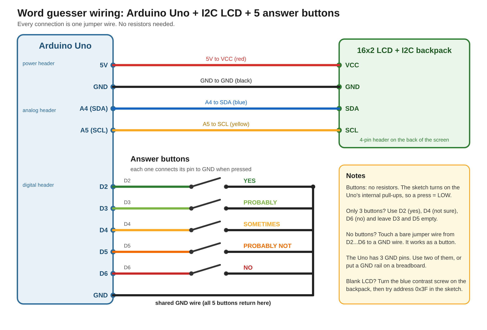
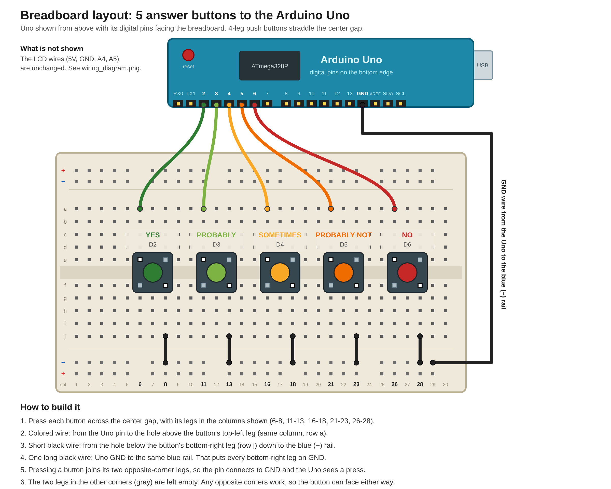

# 20 Questions on an Arduino Uno

A 20-Questions-style guessing game that runs entirely on an Arduino Uno. Think of an object or an idea, answer with five buttons, and it shows its questions and guesses on a 16x2 LCD. It knows 1,200 words, including abstract
ones like "nothing", "love" and "time".

## How it works

1. **Building the knowledge (only run once, on a PC).**
   - My foundation was built around the THINGS dataset, a large collection of everyday objects used by researchers to study how the human brain recognizes and understands things.
   - I used an AI model, Gemma 4 12B, to score how well each of 1,870 words fits each of
     129 yes/no questions, such as "Does it use electricity?". This took about 5 to 6 hours, which is totally possible on a normal AI service like Claude or ChatGPT, however, I used Kaggle's free GPUs for cost efficiency. 
   - The dataset only covers physical objects, so I then later used Claude for the smaller task of adding 39 common abstract ideas and filled in 12 extra abstract questions for them, which makes 140 questions in total.
   - A script then compressed everything by picking the "best" 1,200 words out of 1,870 and 64 questions to fit the Uno's memory.
2. **Playing (on the Uno).** The game is *not* an AI. It keeps a score for every word. Each answer raises the
   score of words that fit and lowers the score of words that don't. It then asks the question that best distinguish
   the words still in the possibility, like a game of elimination.
3. **Guessing.** It guesses when one word is clearly leading in score, drops each wrong guess and carries on. It gives up after
   30 turns (both question and guess count as one turn). Holding the middle button for two seconds and release will make it go back to the last question, this is a redundancy for misclicking.

## Why Gemma 4 12B?

This wasn't just any random model. Before scoring 1,870 words, which is a lot of computing time and power, I tested candidates on a
smaller scale: answer 43 yes/no questions about 12 words whose answers I had already written by hand, using one of
five levels (yes / probably / sometimes / probably not / no). I started with small Qwen 3.5 models on my laptop
(GTX 1650, 4 GB), but they were too slow and hot, so I moved to Kaggle's free T4 GPUs and compared the two
strongest candidates there. The output was forced into a fixed format so a script could read it.

| Measure (12 words) | Qwen 3.5 9B | Gemma 4 12B |
|---|---|---|
| Agreement with my answers | 94% | 95% |
| "Yes" answers found | 82% | **92%** |
| "Yes" answers it invented | 19 | 19 |
| Average error (0 to 1 scale) | 0.13 | **0.10** |
| Time per word | 12.4 s | **8.5 s** |
| Estimated time for 2,000 words | 6.9 h | **4.7 h** |

- **Something I realized:** about 88% of answers are "no", so a model that always said "no" would score 88% on
  agreement alone. Agreement barely separates the models (94% vs 95%), so I also tracked how many "yes" answers
  each one found and how many it invented. The game depends on the "yes" answers.
- **The winner:** Gemma 4 12B found more of the real "yes" answers, had a lower average error and was faster, with the
  same number of invented "yes" answers.
- **Keep inmind:** Only 12 words were tested. The "right" answers are my own judgment/opinion, and several disagreements are
  arguable (for example, I said a clock is not a tool but Gemma said it is). Gemma also over-answered "yes" for
  airplane (wheels, screen, can sit on it), so its table has mistakes.

To reproduce the comparison, run [kaggle/benchmark/kaggle_benchmark.ipynb](kaggle/benchmark/kaggle_benchmark.ipynb) on Kaggle.

## Parts

| Part | Note |
|---|---|
| Arduino Uno | ATmega328P, 2 KB RAM, 32 KB flash |
| 16x2 LCD with I2C backpack | address 0x27 (try 0x3F if the screen stays blank) |
| 5 push buttons (or jumper wires touched to GND) | no resistors needed |

## Wiring

- LCD: GND to GND, VCC to 5V, SDA to A4, SCL to A5.
- Buttons: one side of each button to GND, the other to D2 (Yes), D3 (Probably), D4 (Sometimes / hold = back),
  D5 (Probably not) and D6 (No). The sketch uses the Uno's internal pull-up resistors.
- On a 4-legged push button, use two diagonally opposite legs.

## Run it

1. Install the Arduino IDE. Then install the **LiquidCrystal I2C** library by Frank de Brabander: in IDE 2.x go to Tools → Manage Libraries (in 1.x: Sketch → Include Library → Manage Libraries). I recommend searching for the author's name, "Frank de Brabander".
2. Open [uno_guesser/uno_guesser.ino](uno_guesser/uno_guesser.ino) (keep the three files in that [folder](uno_guesser/) together).
3. Select board **Arduino Uno**, pick your port, and Upload.

Expected size: about 28.3 KB flash (88%) and 1.7 KB RAM (85%) of the Uno's 32 KB / 2 KB. The IDE will show a
"low memory" warning; that is expected.

## Rebuild the word list (optional)

You only need this if you want to change which words or questions the game knows. To just play, skip it.

1. Open a terminal in the `tools` folder.
2. Run `pip install numpy`.
3. Run `python build_v3.py`. This creates a new `uno_table.h` in the same folder.
4. Copy `uno_table.h` into the `uno_guesser` folder, replacing the old one, then upload the sketch to your Uno again.

To change the words, edit the lists near the top of `build_v3.py`. The scores come from `words_full.json`, which the script reads automatically. Everything else in the repo (`kaggle/`, `uno_words.txt`) is for reference.

## Limitations

- Can only fit around 1,200 words, limited by the Uno's 2 KB RAM and 32 KB flash.
- The AI's scores contain mistakes, basically, the answer key itself contains mistakes. "Wrong answers" hurts the accuracy a lot, the "undo" button is only a band aid, not a cure.
- In PC simulation it did well, but the simulated player answers from the same table the game uses, so real
  players will do worse. I have not measured real-player accuracy yet, this will require a web version for most efficiency, not a physical and static Arduino. 
- The 12 newest abstract questions are only filled in for the 39 abstract words I wrote by hand.

## Credits

- THINGS concept database: Hebart et al. (2019), "THINGS: A database of 1,854 object concepts and more than
  26,000 naturalistic object images", PLoS ONE. Used for the word list; please follow its license and cite it.
- Gemma 4 12B (Google), run through Ollama, for scoring answers. Follow the Gemma license terms.
- `wordfreq` was used to estimate how common a word is.
- Code and the abstract-word answers were written with Claude.

Code in this repository is released under the MIT License (see [LICENSE](LICENSE)); the data files keep their original licenses.
